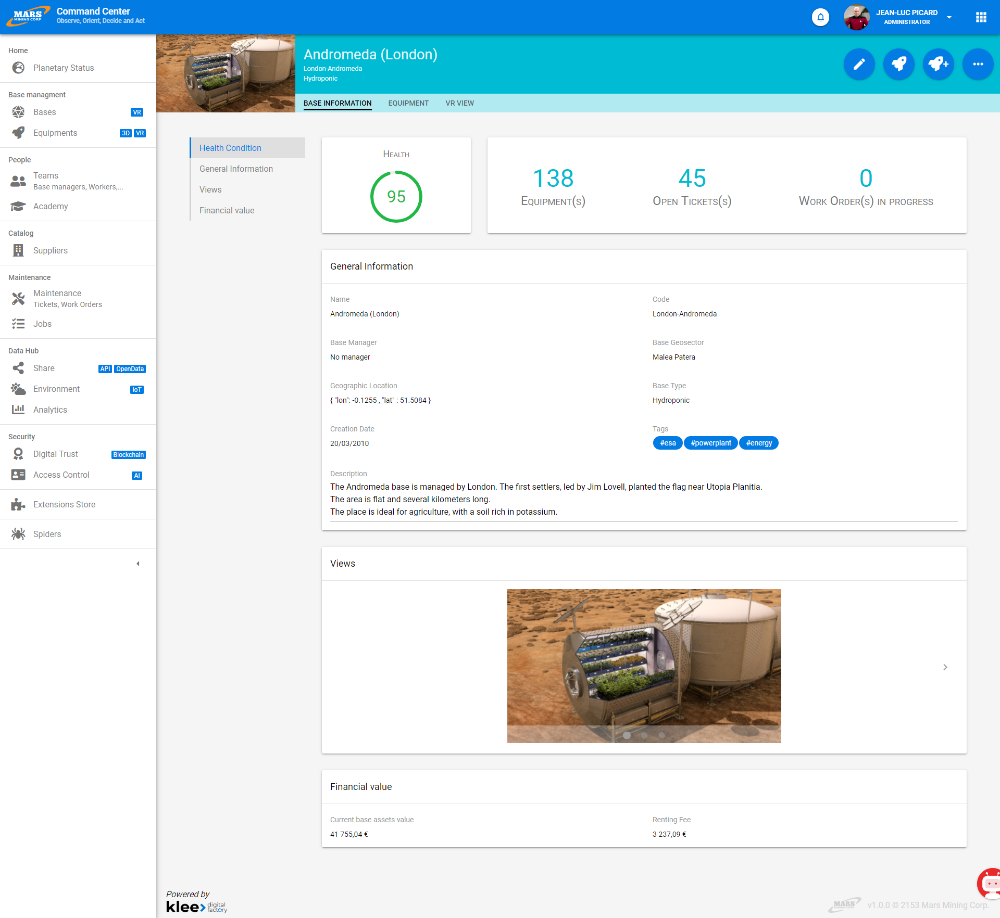
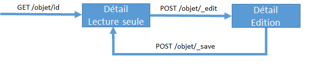
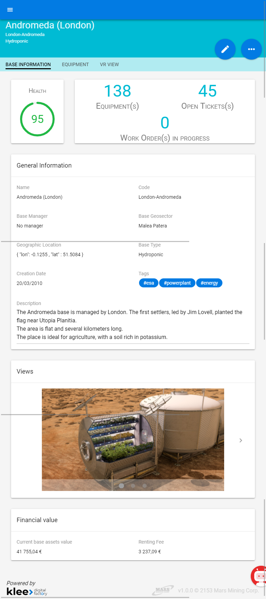

# UI

L'extension vertigo-ui permet la création d'écrans riches, de manière simple et sécurisée.

Pour ce faire, elle s'appuie sur deux frameworks du marché (SpringMVC et Vue.js) auxquels elle adjoint la philosophie de Vertigo : simplicité et robustesse.

*Ecran de détail d'une base dans l'application démo [Mars](https://github.com/vertigo-io/vertigo-mars/tree/master)*


## Principe général

Vertigo propose des écrans et interfaces utilisateur en utilisant le paradigme MPA ou Multiple Page Application et en suivant le pattern MVC.

Ce choix s'explique pour les raisons principales suivantes :

- Utilisation des fonctionnalités natives du web, pour une plus grande compatibilité et une adoption plus simple par une grande variété d'utilisateurs
- Meilleure sécurisation des informations et de l'application
- Simplicité de développement
- Permet de concentrer les efforts sur les écrans à forte valeur ajoutée

Afin d'atteindre cet objectif de création simple d'écrans ergonomiques, fiables et parfaitement adapté aux besoins des utilisateurs, nous proposons une méthode de construction qui utilise un état de vue ou ViewState.

L'idée sous-jacente est donc :

- Sur une application MPA classique, les écrans n'ont pas de cycle de vie, pas de "mémoire", une fois affichés ils n'ont plus d'existance
- Sur une application de type SPA (Single Page Application), les écrans ont une durée de vie "infinie", l'utilisateur est toujours sur le même "écran" tout au long de son parcours utilisateur
- Ce que nous proposons est un intermédiaire où les écrans sont indépendants les uns des autres mais où ils ont une "mémoire" qui leur permet une forte interactivité avec l'utilisateur

Pour la partie *controller*, nous utilisons **SpringMVC** auquel nous avons adjoint des fonctionnalités utiles et le support du ViewState appelé ViewContext dans vertigo-ui.

Pour la partie *model* nous utilisons le ViewContext de Vertigo qui a à sa charge la conservation des données pour mise à disposition de la vue.

Pour la partie *vue* nous utilisons :

- **Thymeleaf** comme moteur de rendu serveur
- **Vue.js** comme librairie de rendu client
- **Quasar** comme bibliothèque de composants graphiques

?> Les sections Configuration, Création d'un controller, et Création de la vue décrivent l'approche vertigo-ui avec SpringMVC. Pour les applications Vega/Javalin, le module vertigo-ui fonctionne en complément via les composants vu:.

## Configuration

La configuration du module vertigo-ui se limite à la configuration d'une application SpringMVC classique via les mécanismes offerts.

Afin de simplifier la configuration et le réaliser simplement le lien entre Vertigo et SpringMVC, nous mettons à disposition deux classes :

- `io.vertigo.ui.impl.springmvc.config.VSpringWebConfig` : classe à étendre qui fournit les éléments de configuration requis
- `io.vertigo.ui.impl.springmvc.config.AbstractVSpringMvcWebApplicationInitializer` : classe à étendre et à placer dans le projet pour initialiser la webapp programmatiquement via le standard servlet 3.0+.

Ainsi, pour configurer le projet *MyProject* avec vertigo-ui, il suffit de créer les deux classes suivantes :

**MyProjectVSpringWebConfig**

```java
@ComponentScan({
		//place here your controller packages for spring component scanning  })
public class MyProjectVSpringWebConfig extends VSpringWebConfig {
	// nothing basic config is enough
	
}
```


**MyProjectVSpringWebApplicationInitializer**

```java
import io.vertigo.ui.impl.springmvc.config.AbstractVSpringMvcWebApplicationInitializer;

public class MyProjectVSpringWebApplicationInitializer extends AbstractVSpringMvcWebApplicationInitializer {

	@Override
	protected Class<?>[] getServletConfigClasses() {
		return new Class[] { MyProjectVSpringWebConfig.class };
	}
}

```

## Création d'un controller 

Pour pouvoir profiter des fonctionnalités de vertigo-ui il est nécessaire que les *controllers* héritent de la classe `io.vertigo.ui.impl.springmvc.controller.AbstractVSpringMvcController`

Pour la création d'un controller permettant d'afficher le détail d'un objet, par exemple *Person*, créer la classe `PersonDetailController`

```java
@Controller
@RequestMapping("/person")
public class PersonDetailController extends AbstractVSpringMvcController {

	private static final ViewContextKey<Person> personKey = ViewContextKey.of("person");

	@Inject
	private PersonServices personServices;

	@GetMapping("/{perId}")
	public void initContext(final ViewContext viewContext, @PathVariable("perId") final Long personId) {
		viewContext.publishDto(personKey, personServices.getPerson(personId));
		toModeReadOnly();
	}

	@GetMapping("/new")
	public void initContext(final ViewContext viewContext) {
		viewContext.publishDto(personKey, personServices.initPerson());
		toModeCreate();
	}

	@PostMapping("/_edit")
	public void doEdit() {
		toModeEdit();
	}

	@PostMapping("/_create")
	public String doCreate(@ViewAttribute("person") final Person person) {
		personServices.createPerson(person);
		return "redirect:/person/" + person.getPersonId();
	}

	@PostMapping("/_save")
	public String doSave(@ViewAttribute("person") final Person person) {
		personServices.updatePerson(person);
		return "redirect:/person/" + person.getPersonId();
	}


}
```


Ce controller offre plusieurs fonctions :

- affichage du détail d'une personne existante via un appel de type `GET` sur l'url `/person/{perId}`
- affichage d'un écran permettant la création d'une nouvelle personne via un appel de type `GET` sur l'url `/person/new`
- passage en mode édition via un appel de type `POST` sur l'url `/person/_edit`
- sauvegarde d'une nouvelle personne via un appel de type `POST` sur l'url `/person/_create`
- sauvegarde d'une personne existante via un appel de type `POST` sur l'url `/person/_save`

Le regroupement de l'ensemble de ces fonctions dans un controller unique est possible grâce à l'utilisation transparente du ViewContext qui permet à chaque requête de conserver les informations de l'appel précèdent. Ainsi, la méthode `doSave` peut récupérer dans le ViewContext (mis à jour via les paramètres inclus dans l'appel POST) l'objet Person à l'aide de l'annotation vertigo-ui `@ViewAttribute` et appeler le service métier adéquat.

> Un appel HTTP de type `GET` aboutit à la création d'un ViewContext vierge
>
> Un appel HTTP de type `POST` permet la récupération d'un ViewContext déjà initialisé et contenant les informations déjà placées par le développeur et enrichi à chaque interaction avec l'utilisateur.

Ainsi, la cinématique typique d'un écran de détail est la suivante :



> Il est important de noter ici que les urls sont ici des **propositions** issues de l'expérience et des bonnes pratiques. Ces urls sont directement modifiables par le développeur.

> Il est également possible d'ajouter autant d'interactions que nécessaire avec l'utilisateur via l'ajout de nouvelles méthodes dans le controller.

Une fois ce controller créé, il ne reste plus qu'a créer la vue correspondante.

## Un même objet, de la base à l'écran :id=meme-objet

Vertigo fait circuler le même objet métier (DtObject), décrit par sa définition, du DAO jusqu'à l'écran. Il n'y a pas un objet par couche (entité, DTO, modèle de vue) relié aux autres par des mappers : ces mappers recopient les champs à l'exécution sans rien apporter, ni en productivité ni en performances, et coûtent à écrire et à maintenir à chaque champ ajouté. La définition de l'objet, avec ses champs et leurs SmartTypes, suffit à l'écran pour formater, contrôler et afficher.

Un DtObject dédié, sans identifiant, se justifie quand l'écran ou l'API montre autre chose que l'entité : des critères de recherche, un objet d'affichage qui réunit plusieurs entités (rempli par une tâche), ou un contrat d'API qu'on veut stabiliser indépendamment du modèle.

Ce choix est sûr, parce que l'échange avec le navigateur est contrôlé :

- **L'objet reste côté serveur.** `publishDto` le place dans le ViewContext, conservé côté serveur entre les requêtes (dans un KVStore). Le navigateur ne reçoit que les champs dont la page a besoin (voir `vueData` dans [Composants vertigo-ui](#composants-vertigo-ui)).
- **La saisie est contrôlée avant d'atteindre l'objet.** Au POST, elle est gardée à part, sous forme de texte, contrôlée par les SmartTypes des champs et par les validateurs, puis reportée dans l'objet : `@ViewAttribute` rend au controller l'objet mis à jour. En cas d'erreur, une `ValidationUserException` est levée avant l'appel du controller, et les messages reviennent sur les champs concernés.
- **Seuls les champs modifiables à l'écran sont acceptés.** Un composant `vu:` qui rend un champ modifiable (ou `vu:include-data` avec `modifiable="true"`) l'enregistre comme tel. À chaque requête, tout paramètre `vContext[...]` non enregistré est rejeté par une `VSecurityException` (réponse 403), avant le controller : un utilisateur ne peut pas modifier un champ que la page n'a pas rendu modifiable, même en forgeant la requête. C'est la parade au *mass assignment*, une faille recensée par l'OWASP.

Les webservices échangent les mêmes DtObject, en JSON, avec des contrôles équivalents (voir [WebServices](/basic/webservices#utilisation-de-paramètres)).
<!-- source : vertigo-ui ViewContextMap.java (publish, addKeyForClient), AbstractVSpringMvcController.java (ViewContext dans le KVStoreManager), ViewAttributeMethodArgumentResolver.java (checkFormat, mergeAndCheckInput, ValidationUserException), VegaUiObject.java (inputBuffer, SmartTypeManager), components/common/utils/include-data.html (addKeyForClient modifiable), VSpringMvcControllerAdvice.java (mapRequestParams : assertAllowedFields), ViewContextUpdateSecurity.java (VSecurityException), VSpringMvcExceptionHandler.java (403) -->

## Création de la vue

Afin de limiter la verbosité du code, nous privilégions une approche *Convention Over Configuration* lorsque cela est pertinent.

L'association entre un controller et la vue correspondante se fait par défaut via une convention de nommage. Un controller dont la classe est `projectroot.my.package.controller.MyObjectDetailController.java` sera associé automatiquement à la vue suivante `WEB-INF/views/my/package/myObjectDetail.html`

> En cas de besoin, le developpeur peut préciser le nom de vue de son choix en utilisant le mécanisme standard fourni par SpringMVC

Pour notre écran de détail, créons la vue suivante :

```html
<!DOCTYPE html>
<html
	xmlns:th="http://www.thymeleaf.org" 
  	xmlns:vu="http://www.morphbit.com/thymeleaf/component">
	<head>
	    <vu:head-meta/>
	    <meta charset="utf-8"/>
	    <meta http-equiv="X-UA-Compatible" content="IE=edge"/>
	    <meta name="viewport" content="width=device-width, initial-scale=1.0"/>
	    <title>Person detail</title>		
	</head>
	
	<body class="desktop">
		<vu:page>
			<div id="page" v-cloak>
				<vu:form>
					<div>
						<vu:button-link th:if="${model.modeEdit}"  url="@{/person/} + ${model.person.personId}" :round size="lg" color="primary" icon="fas fa-ban" :flat ariaLabel="Cancel"   />					
						<vu:button-submit th:if="${model.modeReadOnly}" action="@{_edit}" :round size="lg" color="primary" icon="edit" ariaLabel="Edit" />
					</div>
					<div>
						<vu:block title="Information">
								<vu:text-field object="person" field="firstName" />
								<vu:text-field object="person" field="lastName" />
								<vu:text-field object="person" field="email" />
						</vu:block>
						<div>
							<vu:button-submit th:if="${model.modeEdit}"   icon="save" label="Save" action="@{_save}" size="lg" color="primary" />
							<vu:button-submit th:if="${model.modeCreate}" icon="save" label="Create" action="@{_create}" size="lg" color="primary"/>
						</div>				
					</div>
				</vu:form>
			</div>
	    </vu:page>
	</body>
</html>
```

Nous pouvons ici voir que :

- la vue est un template HTML thymeleaf standard
- la vue utilise des composants utilisant le prefix `vu:` qui sont des composants proposés par vertigo-ui et qui couvrent les besoins principaux
- les composants `vu:head-meta ` et `vu:page` et `vu:form` permettent de gérer le code technique à l'initialisation de la page, import des fichiers javascript, initialisation de l'instance Vue.js et doivent-être présents sur la page. Ce code technique peut être abstrait via l'utilisation de *layouts* (cf [ici](/extensions/ui))
- la même vue est utilisée pour l'édition et la consultation, ce qui permet à la fois d'assurer une cohérence maximale mais également de simplifier le développement

La page est en réalité un template Vue.js qui sera interprété côté client. L'instance Vue.js de chaque page est accessible simplement via la variable *VUiPage*.

## Composants vertigo-ui

Le corps de la page HTML d'un écran vertigo-ui est un template Vue.js qui sera interprété et rendu de manière réactive par Vue.js.

Les composants vertigo-ui encapsulent les composants Vue.js de la bibliothèque de composant Quasar.

Le ViewContext est mis à disposition des composants Vue.js via clé `vueData` de l'instance Vue.

!> Afin de sécuriser au maximum les applications, seules les données demandées par le template côté serveur sont disponibles dans la variable `vueData`. Il est possible de demander l'inclusion d'une donnée au client soit par inclusion d'un composant de haut niveau (par exemple `vu:text-field` inclut nativement le champ de l'objet concerné pour transfert vers le client) ou via le composant `vu:include-data` qui permet de spécifier la clé de contexte à inclure). Les champs modifiables sont seuls acceptés en retour (voir [Un même objet, de la base à l'écran](#meme-objet)).

La liste des composants disponibles dans vertigo-ui est disponible dans le chapitre dédié à [vertigo-ui](/extensions/ui)

## Dynamisme

Grâce à vertigo-ui, il est possible de créer simplement des pages dynamiques en utilisant la puissance de Vue.js et son rendu réactif.

Il est possible d'appeler des méthodes d'un controller via des requêtes XHR en POST qui agissent sur le ViewContext. La méthode du controller n'a alors qu'à retourner le ViewContext qui sera alors automatiquement sérialisé en JSON et ainsi mettre à jour le  `vueData` de l'instance Vue.js de la page.

> L'appel de la méthode `httpPostAjax(url, params)`  mise à disposition sur l'instance *VUiPage* par exemple suite un évènement Vue.js (@change etc..) depuis un composant Vue.js simplifie encore davantage cette cinématique en prenant en charge l'appel XHR et le traitement de la réponse pour mise à jour du `vueData`.

## Responsive

Vertigo UI permet de réaliser des applications responsives (qui s'adaptent à la taille de l'écran). 

*Ecran de détail de la base dans l'application démo [Mars](https://github.com/vertigo-io/vertigo-mars/tree/master) en mode mobile*

